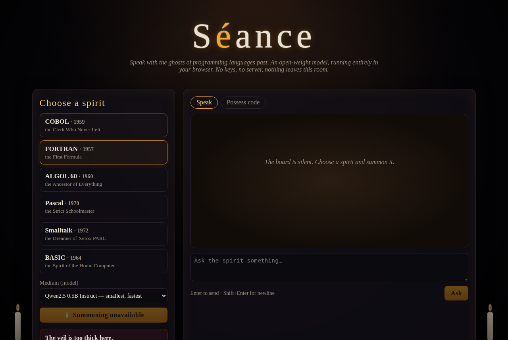

*This is a submission for the [Hacktoberfest Open-Source AI Challenge Week 4: Ghost in the Machine](https://dev.to/challenges/hacktoberfest-week4-2026-10-26)*

## What I Built

Every language you write today is haunted.

Your curly-brace block scope? That's ALGOL 60's ghost. Your `for` loop over an array? FORTRAN got there in 1957. Your "everything is an object"? Smalltalk said it first at Xerox PARC and has been muttering about being misunderstood ever since. And somewhere, right now, a COBOL program written before your parents met is moving your salary between banks.

Día de los Muertos is about remembering the ancestors: setting out marigolds and candles so the dead can find their way home for a night. So I built them an altar.

**Séance** is a small web app where you hold a séance with the spirit of a dead (or "dead") programming language. Six spirits answer the call:

- **COBOL** (1959), the Clerk Who Never Left
- **FORTRAN** (1957), the First Formula
- **ALGOL 60** (1960), the Ancestor of Everything
- **Pascal** (1970), the Strict Schoolmaster
- **Smalltalk** (1972), the Dreamer of Xerox PARC
- **BASIC** (1964), the Spirit of the Home Computer

You pick a spirit, choose a "medium" (an open-weight model) and press **Summon**. A progress bar fills while the medium crosses over, which in practice means the model weights download and compile on your GPU. Then you can ask the spirit anything. Who made you? What did you run? What do you think of JavaScript? The answer streams back like a planchette, one character at a time.

There's a second mode, **Possess code**. Paste a snippet of modern JavaScript, Python or Rust, and the ghost takes it over and rewrites it in its own language, followed by a few lines of in-character commentary on what your code got right and wrong.

The ghost and its voice are open-weight models. The séance itself is three static files, and the model runs in your browser, not on a server.

## Demo

🕯️ **Live:** https://seance-ghost-languages.vercel.app

You'll need a browser with **WebGPU**; a recent desktop Chrome or Edge is the safest bet. Without it the app tells you plainly that "the veil is too thick here" instead of failing silently. The first summoning downloads the model, which can take a few hundred MB to around 1 GB depending on which medium you pick. After that the browser caches it.



## Code

📜 **Repo:** https://github.com/kayode96-max/seance-ghost-languages

No framework and no build step: `index.html`, `style.css`, `ghosts.js` (the spirits) and `app.js` (the summoning). Clone it, run `python3 -m http.server`, and you're ready to start a séance. MIT licensed.

## How I Built It

**The open-source AI at the core** is [WebLLM](https://github.com/mlc-ai/web-llm) from the MLC project (Apache-2.0). It compiles open-weight models to run on WebGPU and gives you an OpenAI-style `chat.completions` API, entirely client-side. I load it straight from a CDN as an ES module:

```js
const webllm = await import("https://esm.run/@mlc-ai/web-llm@0.2.87");
engine = await webllm.CreateMLCEngine(model, { initProgressCallback: onProgress });
```

The `initProgressCallback` drives the "Summoning…" bar, so the slowest part of the experience doubles as the ritual.

**The mediums** are three small open-weight models from WebLLM's prebuilt list, all 4-bit quantized:

- `Qwen2.5-0.5B-Instruct`: tiny and fast, good for a quick chat
- `Llama-3.2-1B-Instruct`: a richer voice
- `Qwen2.5-1.5B-Instruct`: the best of the three at actually translating code

**The spirits are prompts, not fine-tunes.** Each ghost in `ghosts.js` has a persona with its era, its creators, its idioms and its grudges. COBOL talks in DIVISIONS and resents that nobody admits it still runs the banks. BASIC says `READY.` and is still hurt that someone called GOTO harmful. A shared set of rules keeps them in character and brief, and tells them to be *vague and mysterious rather than inventing specifics* when unsure. With a 0.5B model that instruction pulls a lot of weight.

**The ouija reveal** is the part I enjoyed most. Tokens arrive from the model in uneven bursts, so instead of dumping them on screen I push them into a queue that a small timer drains one character at a time. Each character fades in from a blur. When the model runs ahead of the planchette, the timer spells faster to catch up. It's a small trick, but it makes a streaming LLM feel like something is spelling to you from the other side.

**Possess mode** wraps your code in a structured instruction ("translate into idiomatic FORTRAN; reply with a code block, then two or three sentences of eerie commentary") and raises the token budget. Conversations keep the last few turns as memory, and a **Banish** button calls WebLLM's `interruptGenerate()` when a spirit gets long-winded.

The atmosphere is plain CSS: a vignette that flickers like candlelight, marigold accents, candles with animated flames, and a board with a warm wooden glow.

**Honest limits.** These are very small models doing role-play. The ghosts will sometimes misremember a date, and their COBOL won't always compile. I'd treat what they say as folklore. It's a séance, not a reference manual. The 1.5B medium is noticeably better at code if your GPU can handle it.

## Why Open Innovation Matters

This project could only be built this way with open weights, and that's the part I care about most.

- **It runs locally.** Inference happens on your own GPU. No API, no inference server, no account to sign up for.
- **It's private.** Your questions, and any code you paste into Possess mode, never leave your machine. That includes proprietary code from work.
- **It's free, for me and for you.** There's no per-token bill, so I can host it as a static site and anyone can use it as much as they like without me worrying about cost.
- **It works offline after the first load.** Once the browser has cached the weights, the séance doesn't need a connection to any inference service.
- **You can swap the medium.** If a better small open model comes out next month, switching is one line. Nobody can deprecate the model out from under it.

There's a fitting symmetry here. COBOL, FORTRAN and ALGOL were shared openly as specifications and standards, and they shaped everything that came after them. Open-weight models are doing something similar now: they're the shared ancestors the next generation of tools will grow out of. Leaving them open, and running them on our own machines, is how we make sure the future gets the chance to remember them too.

Light a candle for your favourite dead language, and go ask it what it thinks of you. 🕯️🌼
