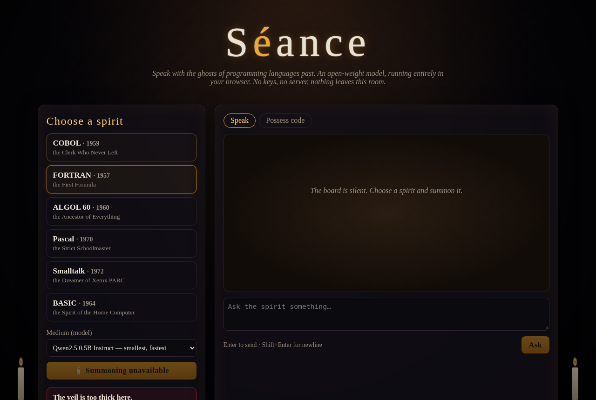

# 🕯️ Séance — speak with the ghosts of dead programming languages

> *Ghost in the Machine.* A séance where the dead are COBOL, FORTRAN, ALGOL 60, Pascal, Smalltalk and BASIC — and the medium is an open-weight language model running **entirely in your browser**.



Pick a spirit, light the candles, and ask it about its life: who made it, what it ran, what it thinks of your `async`/`await`. Or switch to **Possess code**: paste a snippet of modern JavaScript, Python or Rust and the ghost rewrites it in its own tongue, with a few eerie words about what it found.

Built for the DEV **Hacktoberfest Open-Source AI Challenge — Week 4: Ghost in the Machine**, in the spirit of Día de los Muertos: remembering the ancestors whose ideas still live inside every language we use.

## Why it runs locally

- **Open-weight model, in-browser.** [WebLLM](https://github.com/mlc-ai/web-llm) (Apache-2.0) runs quantized open-weight models on your GPU via WebGPU. You can choose Qwen2.5-0.5B-Instruct, Llama-3.2-1B-Instruct or Qwen2.5-1.5B-Instruct (all q4f16_1 MLC builds).
- **No server, no API key, no account.** The site is three static files. Your questions and your code never leave your machine.
- **Free and offline-capable.** Model weights are downloaded once and cached by the browser; after that the séance works without a network connection to any inference service.
- **Swappable.** Changing the medium is one line in the `<select>` — any model in WebLLM's prebuilt list will do.

## Features

- Six ghosts, each with a persona prompt (era, creators, idioms, grudges against modern languages) in [`ghosts.js`](ghosts.js)
- **Speak** mode: streaming, in-character conversation with short memory (last few turns)
- **Possess code** mode: translate modern code into the ghost's language plus commentary
- Ouija-style reveal: the model's streamed tokens are spelled out character by character
- "Summoning…" progress bar while weights download/compile; a **Banish** button to stop generation
- Graceful fallback when WebGPU isn't available

## Run it

No build step.

```bash
git clone <this repo> && cd seance
python3 -m http.server 8000   # any static server works
# open http://localhost:8000 in Chrome/Edge (desktop) with WebGPU
```

Requirements: a browser with WebGPU (recent Chrome or Edge on desktop is the safe bet) and a few hundred MB to ~1 GB of free space for the model cache, depending on the model.

## Honest caveats

These are small models doing role-play. The ghosts are charming but they *will* misremember dates and write imperfect COBOL. Treat their history as folklore and their code as a séance transcript, not a compiler target. The larger Qwen2.5-1.5B medium gives noticeably better translations.

## Files

| File | What |
|---|---|
| `index.html` | Markup |
| `style.css` | Candlelight, marigolds, ouija board |
| `ghosts.js` | The spirits' personas and prompts |
| `app.js` | WebGPU check, WebLLM loading, streaming chat, ouija reveal |

## License

MIT © 2026 Usman Olukayode. WebLLM is Apache-2.0; model weights are under their own licenses (Qwen2.5: Apache-2.0 for 0.5B/1.5B; Llama 3.2: Llama 3.2 Community License).
